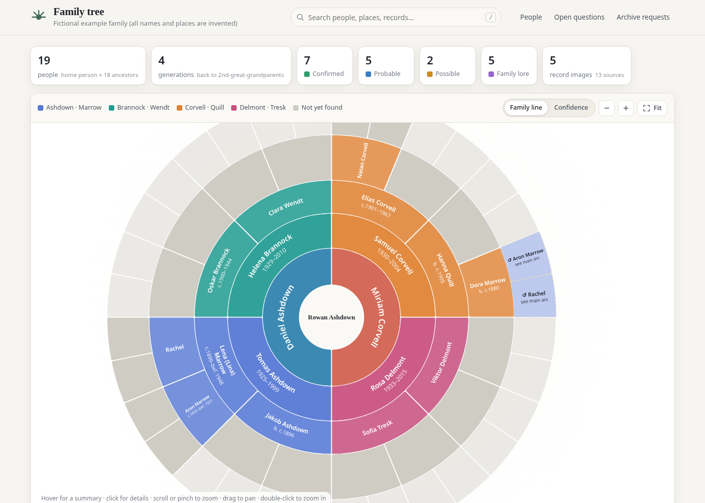
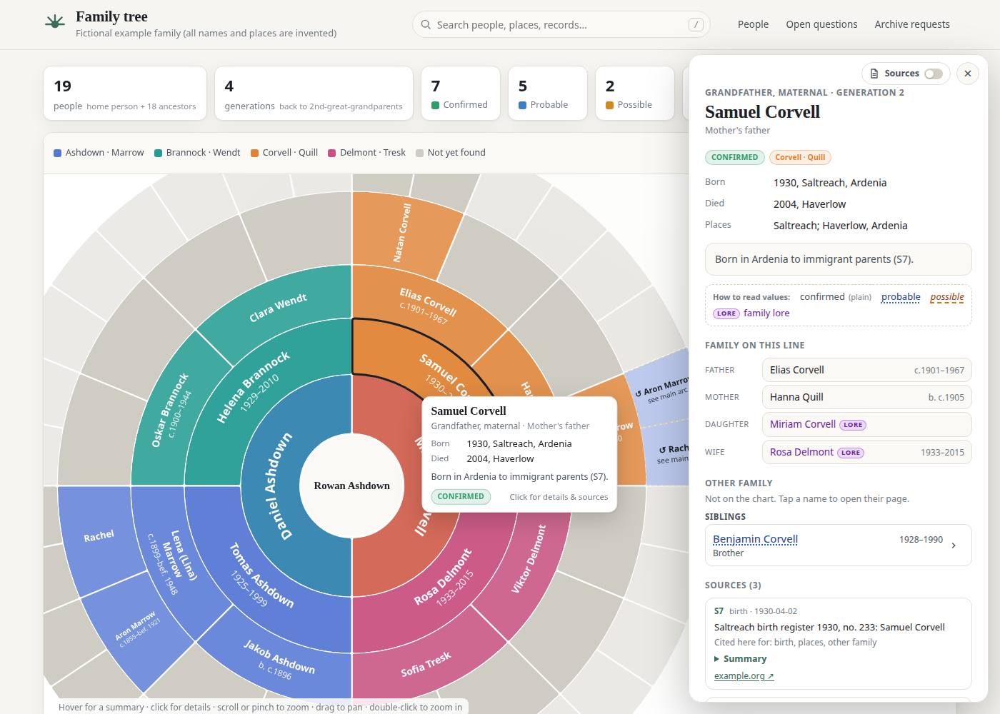
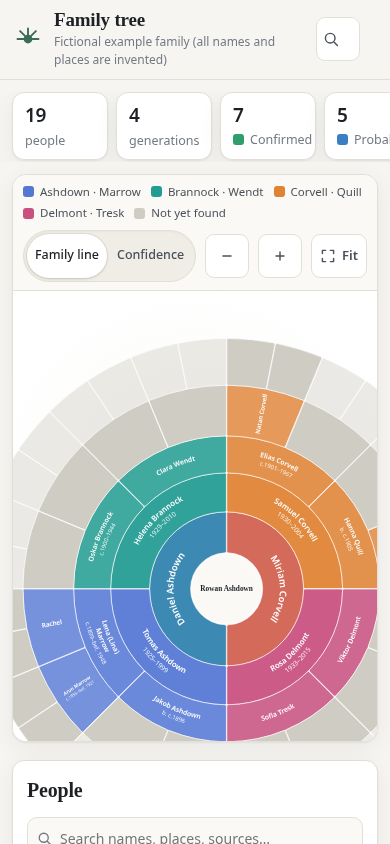
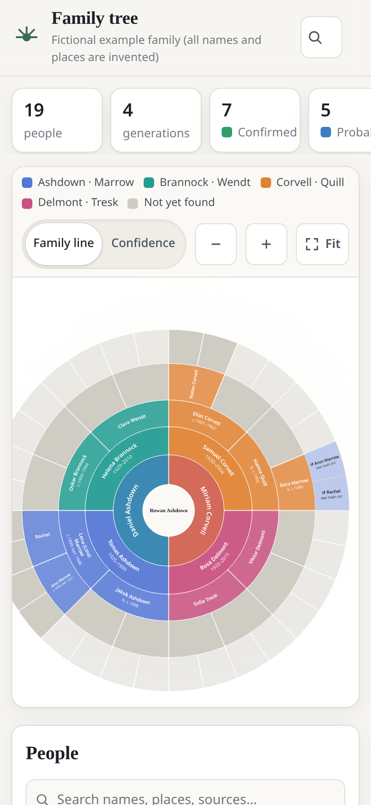
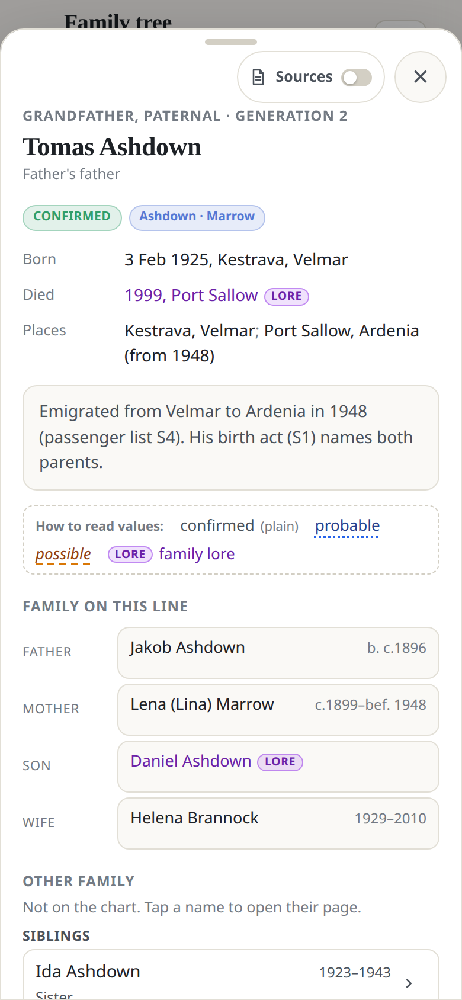
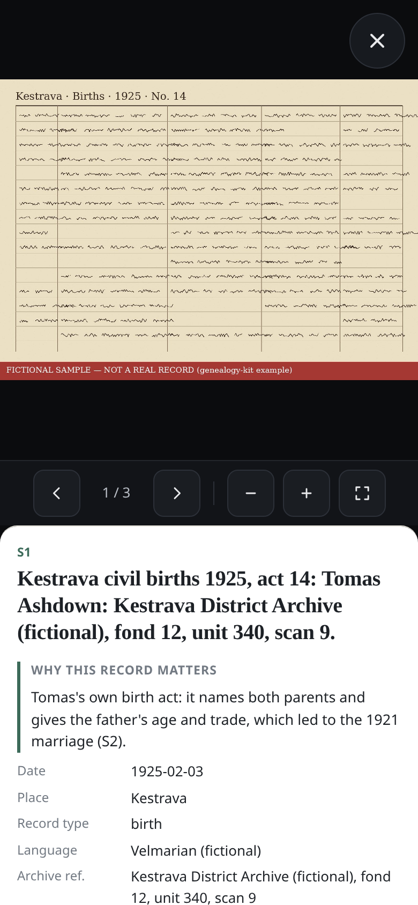
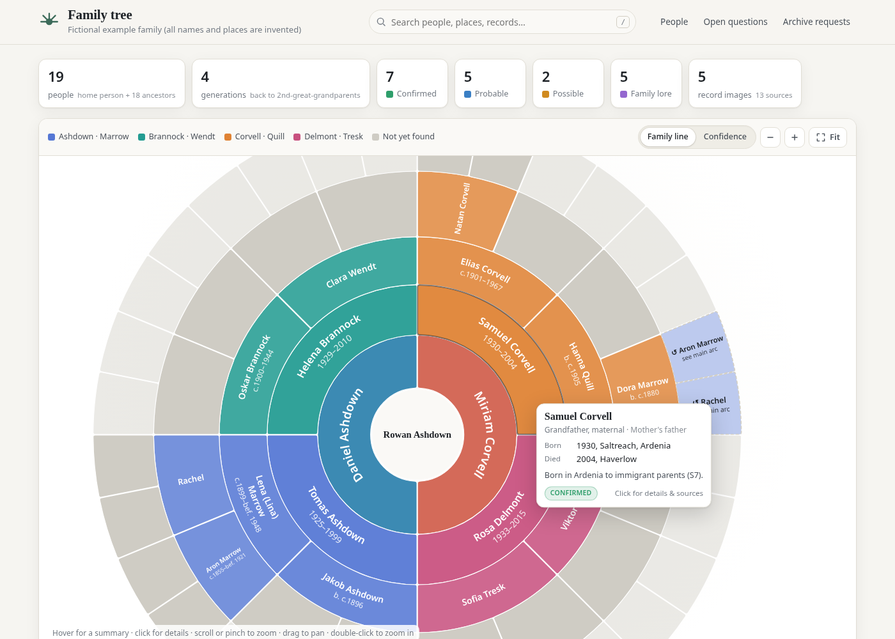
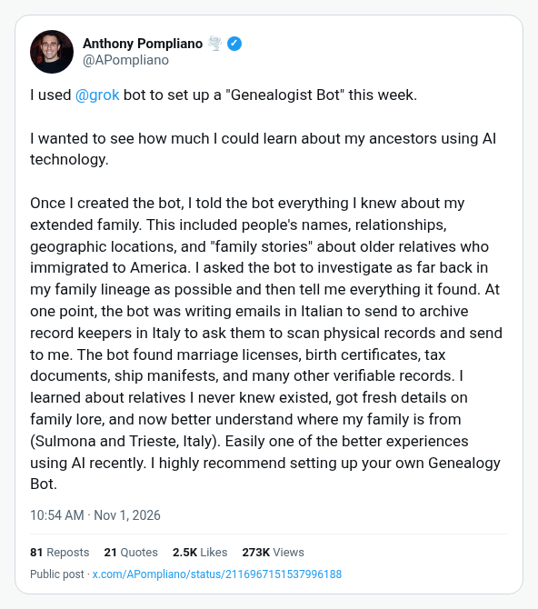

# Family Tree Kit

A research kit for **long-running AI agents** that trace a family's ancestry as far back as the
records go — with every claim tied to a record the user can open — and, optionally, publish it as a
**private** family-tree website behind a login.

It contains the **method** (how to interview, search, read and cite records, handle collateral
relatives and archive requests), the **agent instructions**, empty **templates** for the research
files, small **tools**, and the **site generator**. It contains **no personal data**: every name,
place and record in this repository belongs to an invented example family.



| Person panel (fictional example) | Phone layout |
|---|---|
|  |  |

| Phone: fan chart | Phone: person panel | Phone: record + why it matters | Desktop: hover tip |
|---|---|---|---|
|  |  |  |  |

*All screenshots show the fictional example in `site/example/` ("Velmar", "Ardenia" and every
person in it are invented; the record images are generated placeholders).*

## Install the private site as an app (PWA)
The generated site ships a web app manifest, service worker and fan-chart home-screen icons.
On phone or desktop, open the published URL (behind your login), use the browser’s **Add to Home Screen** / **Install**, and you get a standalone Family Tree app with the circular fan icon.

## What you need
**A plain chat assistant is not enough.** The agent must have:
- **persistent files** (research runs over days or weeks, with hundreds of files and scans);
- a **shell** with Python 3 (+ Pillow), Node.js (npm) and curl;
- a **browser it can drive** (many archives are JavaScript viewers or block plain HTTP clients);
- **image reading** (handwritten registers in many languages and scripts);
- **background / long-running work** and **scheduling** (research passes, reply watch, Access check);
- **secret storage** (the user's logins and the Cloudflare token);
- a way to **ask the user** and get approvals.

## Quick start

### Option 1 — Point your Grok Bot at this repo
Paste this into Grok Bot:
> Set up genealogy research for my family using the family-tree-kit repository at `<repo URL or path>`.
> Read AGENT.md and follow it step by step: create a private data folder, save the rules to memory,
> then interview me one question at a time. Use free sources first, contact no one, and ask me
> before any login, payment, archive letter or website deploy.

Grok Bot runs research passes in background workers, uses its own browser for archive viewers, keeps
logins in its vault, asks you with choice buttons, writes long reports as Pages, and can run the
recommended routines.

### Option 2 — Any agent with those capabilities
Give it `AGENT.md` as its instructions. The table at the end of `AGENT.md` maps each Grok Bot term
(background worker, vault, routine, choice widget, Page) to a generic equivalent (sub-process, secret
store, cron, numbered question, report file).

### Try the site locally (no account needed)
```
cd site && npm install && cd ..
python3 site/build.py                     # builds the fictional example into build/example-site/
python3 tools/screenshot.py build/example-site docs --require-example   # optional
python3 tools/screenshot_interactive.py build/example-site docs [--tip-only]   # optional; needs `pip install playwright` + Chrome
python3 -m unittest discover -s site/tests
python3 -m unittest discover -s tools/tests
```

## How it fits together
```
family-tree-kit/  (this repo, public, no personal data)       ~/genealogy-trees/<tree>/  (PRIVATE, created by the agent)
  AGENT.md  METHODOLOGY.md  agent/  templates/  tools/  ──►    people.md sources.md records/ collateral/ drafts/ …
  site/build.py  site/web/  ◄── reads ───────────────────────  site/people_spec.py  site/site.config.json
        │
        └── builds a static site ──► Cloudflare Pages project with a random name, behind Cloudflare Access
```

| Path | What |
|---|---|
| [AGENT.md](AGENT.md) | step-by-step bootstrap for the agent |
| [METHODOLOGY.md](METHODOLOGY.md) | the research process: IDs, confidence labels, the search loop, evidence, collateral, archives, lessons learned |
| [FEATURES.md](FEATURES.md) | what the site does, the privacy and deploy model |
| [SECURITY.md](SECURITY.md) | privacy rules, Access-before-data, token scope, the privacy sweep |
| [agent/](agent/) | rules, interview guide, worker brief template and pass briefs, routines, source catalogue by region |
| [templates/](templates/) | empty research files, sidecar example, collateral rules |
| [tools/](tools/) | project setup, backups, ID checks, sidecars and indexes, scans, polite queries, Access check, privacy sweep |
| [site/](site/) | the generator (`build.py`, `pwa.py`, `web/`), config, the fictional example, tests |

## Privacy promise
- Research data, record images, the curated spec and the site config live **only** in the private
  folder. The repo ships an invented family.
- The site is deployed only after Cloudflare Access is **verified** (302 to your Access login) on
  production and preview URLs; the deploy re-checks afterwards.
- No surnames in the project name, domain, page title or app name; strict publication defaults
  for possibly-living people; no third-party scripts; not indexable.
- The agent contacts no one: it drafts archive letters, **you** send them.

## Inspiration

[Anthony Pompliano](https://x.com/APompliano) wrote about setting up a **Genealogist Bot** with Grok Bot and digging deep into his own family history — a vivid public example of what one person can already do with a capable agent:

[Anthony Pompliano](https://x.com/APompliano) — [Genealogist Bot (X)](https://x.com/APompliano/status/2116967151537996188)

[](https://x.com/APompliano/status/2116967151537996188)

*Screenshot of [Pompliano](https://x.com/APompliano)’s [public post](https://x.com/APompliano/status/2116967151537996188) (GitHub README does not reliably render live X embeds, so the image is included for the feed view; click through for the original).*

In spite of that — individuals already doing this with Grok Bot — **we created this project so anyone can do it**: the research method, agent instructions, templates, tools, and a private family-tree site kit, not gatekept to one person’s bot.

### A future idea (not in this kit today)

Separately, we would like to see a **distributed volunteer / distributed-compute archive project**: people (and their agents) could **optionally** contribute lightweight **text findings**, proofs, and links — and, if images are involved at all, only **minimal processed record snippets** — so others can reuse hard-won archive leads without reinventing the search. **Personal trees would not live in a central store.** This kit does **not** implement that; it remains a local/private research + site kit. Contributions, if any such network appears later, would be opt-in and separate from your private tree folder.

## Credits and thanks
This kit stands on the shoulders of giants. With real gratitude to the people who built and maintain the work it relies on:

- **[D3](https://d3js.org/)** ([GitHub](https://github.com/d3/d3)) — the heart of the circular fan chart (`site/web/fan.js`: hierarchy, partition, arc, zoom, colour interpolation). D3 was created by [Mike Bostock](https://bost.ocks.org/mike/) and is maintained with [Philippe Rivière](https://github.com/Fil) and [many contributors](https://github.com/d3/d3/graphs/contributors). Thank you — the chart simply would not exist without it. ISC licence; copied into each build's `vendor/`.
- **[webtrees fan chart](https://github.com/magicsunday/webtrees-fan-chart)** by [Rico Sonntag (magicsunday)](https://github.com/magicsunday), a module for [webtrees](https://webtrees.net/) — the inspiration for our fan chart's look and layout (already noted in `fan.js` and the site footer). Our `fan.js` is written from scratch, but the idea came from this lovely project.
- **[Fuse.js](https://www.fusejs.io/)** ([GitHub](https://github.com/krisk/Fuse)) by Kiro Risk and contributors — fuzzy search over people, places and records (`site/web/search.js`). Apache-2.0; copied into `vendor/`.
- **[Pillow](https://python-pillow.org/)** ([GitHub](https://github.com/python-pillow/Pillow)), the friendly PIL fork by Jeffrey A. Clark and contributors — record-image re-encoding, PWA icons and image helpers in `tools/`.

Optional screenshot tooling for the fictional example only: [Playwright](https://playwright.dev/). Deploy uses Cloudflare Pages / Access via Wrangler (`npx`); that is hosting, not a vendored library.

The data structure, person panel and record lightbox were designed for this kit; the repo does not document borrowing them from another family-tree product, so none is credited here. If you recognise an influence we missed, please tell us and we will gladly add it.

## Licence
MIT for the code and docs (see [LICENSE](LICENSE)). Vendored libraries keep their own licences:
D3 (ISC) and Fuse.js (Apache-2.0), copied into each build's `vendor/LICENSES.txt`.
