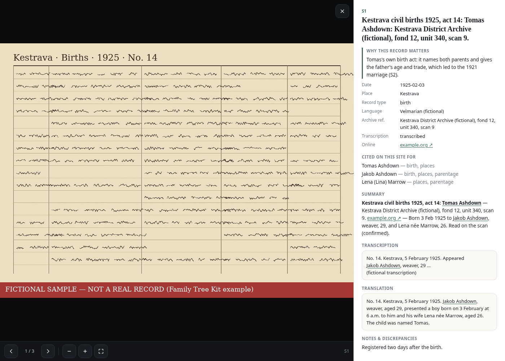

# Family Tree Kit

A research kit for **long-running AI agents** that trace a family's ancestry as far back as the
records go — with every claim tied to a record the user can open — and, optionally, publish it as a
**private** family-tree website behind a login.

It contains the **method** (how to interview, search, read and cite records, handle collateral
relatives and archive requests), the **agent instructions**, empty **templates** for the research
files, small **tools**, and the **site generator**. It contains **no personal data**: every name,
place and record in this repository belongs to an invented example family.


<p align="center"> </p>

### Mobile

<p align="center">&nbsp;&nbsp;&nbsp;&nbsp;&nbsp;&nbsp;</p>

*All names, places and records in these screenshots are invented.*

## Approach

This kit exists so a capable agent can run a long genealogy project the same way a careful human
researcher would: every fact has a source you can open, every link is labelled for how sure it is,
and nothing personal ever lands in the public repository.

The method is spelled out in [METHODOLOGY.md](METHODOLOGY.md) and the agent briefs under
[agent/](agent/). In short:

- **Interview first.** One question at a time. Capture what the family already knows as **family
  lore** (U-sources), including spelling uncertainty, maiden names, and origin towns.
- **Cited facts only.** Every claim gets a source ID (S- or U-number) and one of four confidence
  labels: **confirmed**, **probable**, **possible**, or **family lore**. Labels apply per fact, not
  only per person.
- **Free sources first; read the scan.** Indexes are leads. A fact becomes confirmed only after the
  record image (or an authoritative transcript) is read. Negatives and blocked searches are logged
  so the next pass does not repeat them.
- **Record everyone the record shows.** When you record a person, record every known sibling and
  their parents. Siblings, half-siblings, a spouse's parents, and related witnesses or informants
  get their own entries. Encode a sibling relationship through shared parents, or through an
  explicit sibling list with a citation and a confidence on that link. Every person's page — on
  the chart and off it — lists all known siblings.
- **The user decides.** The agent proposes relationship links and confidence changes; it never
  applies them alone. Archive letters are drafted by the agent and **sent by the user**.
- **Append-only research files.** Back up before edits; correct by adding a dated section, never by
  rewriting history.

### Inspiration

[Anthony Pompliano](https://x.com/APompliano) wrote about setting up a **Genealogist Bot** with Grok Bot and digging deep into his own family history — a vivid public example of what one person can already do with a capable agent:

[Anthony Pompliano](https://x.com/APompliano) — [Genealogist Bot (X)](https://x.com/APompliano/status/2116967151537996188)

[](https://x.com/APompliano/status/2116967151537996188)

*Screenshot of [Pompliano](https://x.com/APompliano)’s [public post](https://x.com/APompliano/status/2116967151537996188) (GitHub README does not reliably render live X embeds, so the image is included for the feed view; click through for the original).*

In spite of that — individuals already doing this with Grok Bot — **we created this project so anyone can do it**: the research method, agent instructions, templates, tools, and a private family-tree site kit, not gatekept to one person’s bot.

## What it does

- A full research method for long-running agents: interview, recursive search, evidence handling,
  collateral / FAN-club work, archive-request drafting, and audit passes.
- Empty templates and small tools for IDs, sidecars, backups, polite queries, Access checks and a
  privacy sweep.
- An optional **private** static site: circular fan chart, person panels with per-fact confidence
  styling, an **All known siblings** list on every on-chart and off-chart person, record lightbox
  with "why this record matters", fuzzy search, people table, open questions and archive-request
  status. A person's title uses the record spelling, with a different family spelling in
  parentheses (`Record Spelling (Family Spelling)`); other spellings are listed as **Also recorded
  as**, and a suspected same person is a **Possible match** until you say to merge.
  `check_ids.py --spec` and the build warn when a named sibling or child of a couple is
  not encoded, a sibling link is not reciprocal, a panel would list fewer siblings than the
  files record, a title disagrees with a cited record spelling, an alias has no source, or two
  people share a near-identical name and close birth years with no possible-match or exclusion.
- Confidence shown as colored words in the legend (`confirmed`, `probable`, `possible`, `family
  lore` with a LORE pill) — no sample dates that look like real profile values.
- Installable as a PWA (manifest, service worker, fan-chart icons) once the site is published behind
  a login.
- A fictional example family only in this repo; real trees live in a private folder the agent
  creates.

## How it works

Two halves: **research and data**, then **visualization**. The public kit never holds personal data;
the agent builds a private project folder and the site generator reads that folder.

```text
Data ingestion and processing
  interview + family lore
       |
       v
  record searches (free archives, indexes)
       |
       v
  sources, scans, record sidecars
       |
       v
  people.md  |  sources.md  |  relationships.md
       |
       v
  ID checks + process-word lint + privacy checks

Visualization
  site/build.py  -->  static fan-chart PWA
       |
       v
  deploy behind Cloudflare Access login
```

**1. Data ingestion and processing.** The agent interviews, searches free archives and indexes,
downloads scans, writes append-only research files and record sidecars, and keeps collateral
relatives in their own folder. `tools/check_ids.py` (and the site build) warn when other-family
lists look thin or when site-facing notes talk about migration/build process instead of the person.
Local privacy hooks and a name-blind public CI check try to keep personal data out of this repo
before anything is shared.

**2. Visualization.** `site/build.py` reads the private curated spec and research files, re-encodes
record images, vendors D3 and Fuse.js, and writes a static PWA. Deploy is opt-in: Access must
redirect to a login **before** any real data is uploaded, and the deploy script re-checks afterwards.
See [FEATURES.md](FEATURES.md) and [SECURITY.md](SECURITY.md).

| Path | What |
|---|---|
| [AGENT.md](AGENT.md) | step-by-step bootstrap for the agent |
| [METHODOLOGY.md](METHODOLOGY.md) | the research process: IDs, confidence labels, the search loop, evidence, collateral, archives, lessons learned |
| [FEATURES.md](FEATURES.md) | what the site does, the privacy and deploy model |
| [SECURITY.md](SECURITY.md) | privacy rules, Access-before-data, token scope, the privacy sweep |
| [agent/](agent/) | rules, interview guide, worker brief template and pass briefs, routines, source catalogue by region |
| [templates/](templates/) | empty research files, sidecar example, collateral rules |
| [tools/](tools/) | project setup, backups, upgrades, ID checks, sidecars and indexes, scans, polite queries, Access check, privacy sweep |
| [migrations/](migrations/) | data-shape scripts the upgrade command runs, one file per version that needs one |
| [site/](site/) | the generator (`build.py`, `pwa.py`, `web/`), config, the fictional example, tests |

## Privacy

Personal data belongs only in the private project folder and, if you deploy, behind a login. This
repository ships an invented family. Several **safeguards** reduce the chance that private names or
secrets leak into the public kit — they are filters and review steps, **not a guarantee**:

- Research files, record images, the curated spec and the site config live **only** in the private
  folder. Screenshots in this README are of the fictional example only.
- Pattern-based local sweeps (`privacy_grep.py` with a per-project private word list) and a
  **name-blind** public CI mode check for secret shapes, forbidden paths and non-example images.
  Pattern matching can miss variants; the public check never sees your real names.
- Pre-commit / pre-push hooks (local, never committed) and `--public-ci` on pull requests are
  backstops. A human still reviews every PR before merge — especially screenshots.
- The site deploys only after Cloudflare Access is verified (302 to your Access login) on production
  and preview URLs; the deploy re-checks afterwards. No surnames in the project name, domain, page
  title or app name; strict publication defaults for possibly-living people; no third-party scripts;
  not indexable.
- The agent contacts no one: it drafts archive letters, **you** send them.

Treat these as layers that lower risk. Always assume a check can miss something; review before
anything goes public. Details: [SECURITY.md](SECURITY.md).

## Build log

### Research and data
- **v0.2.18** — `tools/upgrade.py` backs up a project, runs any data-shape migrations newer than `KIT_VERSION`, and runs the id and build checks. v0.2.16 and v0.2.17 migrations add empty spec fields when they are missing.
- **v0.2.17** — name spelling: the title follows the earliest or most official record; a family spelling goes in parentheses and does not replace it. `check_ids.py` and the build warn when a title disagrees with a cited record spelling, an alias has no source, or two near-identical names with close birth years have no possible-match or exclusion entry.
- **v0.2.16** — record every known sibling and their parents (shared parents, or an explicit sibling list with citation and confidence). `check_ids.py` and the site build warn when those people are not linked, a sibling link is not reciprocal, or a panel would show fewer siblings than the files record.
- **v0.1.0** — first kit: method, agent instructions, templates, tools, fictional example, migration feedback from earlier research work.
- **v0.2.0–v0.2.1** — research-process lessons (backups, negatives, indexes-first, propose-before-changing links); confidence qualifiers; home-person merge and draft renumbering; private-words list required.
- **v0.2.2–v0.2.3** — safer draft renumbering; privacy whole-word + simple suffixes; `--strict` required before sharing.
- **v0.2.10** — multi-layer privacy filters: `GENEALOGY_PRIVATE_WORDS`, pre-commit/pre-push hooks, name-blind `--public-ci`, public CI workflow.
- **v0.2.12** — record every relationship a record shows; warn when `OTHER_FAMILY` / `RELATIVES` look empty; warn on process wording in person notes.
- **v0.2.15** — process-word lint also flags agent bookkeeping in source titles, summaries and notes (`parent agent`, `the user`, `Pass N`, message ids, …).
- **v0.2.14** — same process-word lint on record sidecars: "Why this record matters", Notes, Summary.

### Site and docs
- **v0.2.19** — the footer shows the kit version before the last-updated date (`v0.2.19 · Last updated 6 Nov 2026`). The offline prompt says **Save for offline use**.
- **v0.2.17** — person panels show `Record Spelling (Family Spelling)` when those differ, then **Also recorded as** (each spelling with its source) and **Possible match** for a candidate that is not merged.
- **v0.2.16** — every person panel, on the chart and off it, lists all known siblings. Each link keeps its own confidence and sources. Fan positions stay the same.
- **v0.2.4–v0.2.6** — README screenshots from the fictional example (including interactive panel, evidence and hover-tip shots).
- **v0.2.7–v0.2.9** — credits and thanks; Inspiration (Pompliano); note of a future distributed-archive idea (not implemented).
- **v0.2.11** — first public release of the kit.
- **v0.2.13** — confidence legend colors the words themselves; no sample date values like "1912".

Full notes: [CHANGELOG.md](CHANGELOG.md).

## Limitations

- **No linking across trees.** Each family tree is its own private project folder. `new_project.py`
  creates sibling folders and refuses to nest one tree inside another; there is no tool to connect,
  merge or sync two trees (shared ancestors, shared people IDs, or a combined site).
- **No GEDCOM import or export.** The data model is the kit's Markdown / sidecar / `people_spec.py`
  files. There is no GEDCOM reader or writer in this repository.
- **Depends on free online sources first.** Many archives need a login, a captcha, or an off-line
  request. The agent does not bypass walls; those paths stay on a "needs the user" list or become
  draft archive letters for you to send.
- **Agent output still needs a human.** Relationship links and confidence changes are proposals until
  you approve them. Pull requests are reviewed by a person before merge.
- **Privacy checks are pattern-based.** The local word list catches listed forms (plus a few simple
  suffixes); it does not stem or understand context. Public CI is deliberately name-blind. Both can
  miss things.
- **Fan chart shows direct ancestors only.** Collateral and other relatives are not rings on the
  chart. Every person panel still lists all known siblings, on the chart and off it, when those
  links are recorded (shared parents or an explicit sibling list). The check warns when the files
  name siblings the panels would not show; it does not invent siblings that were never recorded.
- **Single protected site per tree.** The intended deploy is one Cloudflare Pages project behind
  Access for that tree. GitHub Pages and other public static hosts are not suitable.
- **Handwriting and indexes remain hard.** Misreadings and weak index hits are expected; the method
  treats indexes as leads and keeps reading corrections append-only.

## Run it

### What you need

**A plain chat assistant is not enough.** The agent must have:

- **persistent files** (research runs over days or weeks, with hundreds of files and scans);
- a **shell** with Python 3 (+ Pillow), Node.js (npm) and curl;
- a **browser it can drive** (many archives are JavaScript viewers or block plain HTTP clients);
- **image reading** (handwritten registers in many languages and scripts);
- **background / long-running work** and **scheduling** (research passes, reply watch, Access check);
- **secret storage** (the user's logins and the Cloudflare token);
- a way to **ask the user** and get approvals.

### Option 1 — Point your Grok Bot at this repo

Paste this into Grok Bot:

> Set up genealogy research for my family using the family-tree-kit repository at `<repo URL or path>`.
> Read AGENT.md and follow it step by step: create a private data folder, save the rules to memory,
> then interview me one question at a time. Use free sources first, contact no one, and ask me
> before any login, payment, archive letter or website deploy.

Grok Bot runs research passes in background workers, uses its own browser for archive viewers, keeps
logins in its vault, asks you with choice buttons, writes long reports as Pages, and can run the
recommended routines.

### Option 2 — Any agent with those capabilities

Give it `AGENT.md` as its instructions. The table at the end of `AGENT.md` maps each Grok Bot term
(background worker, vault, routine, choice widget, Page) to a generic equivalent (sub-process, secret
store, cron, numbered question, report file).

### Try the site locally (no account needed)

```
cd site && npm install && cd ..
python3 site/build.py                     # builds the fictional example into build/example-site/
python3 tools/screenshot.py build/example-site docs --require-example   # optional
python3 tools/screenshot_interactive.py build/example-site docs [--tip-only|--evidence-only]   # optional; panel + hover tip, desktop evidence (mobile shots unless a flag); needs `pip install playwright` + Chrome
python3 -m unittest discover -s site/tests
python3 -m unittest discover -s tools/tests
```

### Upgrading

When the kit updates, run `python3 tools/upgrade.py <project>` (`--dry-run` shows what would run). It backs up the project inside that folder, applies any newer scripts in `migrations/`, writes `KIT_VERSION`, and runs `check_ids` and the site build. Don't hand-migrate.

### Save the private site for offline use (PWA)

Once you have published a tree behind your login, open the URL on phone or desktop. The footer
offers **Save for offline use**, which keeps the site on the device for offline viewing. Add it
to the home screen (the browser’s **Add to Home Screen** / **Install**) and it opens like an app,
with the circular fan icon. The generator ships the manifest, service worker and icons.

## License

MIT for the code and docs (see [LICENSE](LICENSE)). Vendored libraries keep their own licences:
D3 (ISC) and Fuse.js (Apache-2.0), copied into each build's `vendor/LICENSES.txt`.
Third-party notes, and the still-open choice for the docs, are in [NOTICE](NOTICE).

## Credits and thanks

This kit stands on the shoulders of giants. With real gratitude to the people who built and maintain the work it relies on:

- **[D3](https://d3js.org/)** ([GitHub](https://github.com/d3/d3)) — the heart of the circular fan chart (`site/web/fan.js`: hierarchy, partition, arc, zoom, colour interpolation). D3 was created by [Mike Bostock](https://bost.ocks.org/mike/) and is maintained with [Philippe Rivière](https://github.com/Fil) and [many contributors](https://github.com/d3/d3/graphs/contributors). Thank you — the chart simply would not exist without it. ISC license; copied into each build's `vendor/`.
- **[webtrees fan chart](https://github.com/magicsunday/webtrees-fan-chart)** by [Rico Sonntag (magicsunday)](https://github.com/magicsunday), a module for [webtrees](https://webtrees.net/) — the inspiration for our fan chart's look and layout (already noted in `fan.js` and the site footer). Our `fan.js` is written from scratch, but the idea came from this lovely project.
- **[Fuse.js](https://www.fusejs.io/)** ([GitHub](https://github.com/krisk/Fuse)) by Kiro Risk and contributors — fuzzy search over people, places and records (`site/web/search.js`). Apache-2.0; copied into `vendor/`.
- **[Pillow](https://python-pillow.org/)** ([GitHub](https://github.com/python-pillow/Pillow)), the friendly PIL fork by Jeffrey A. Clark and contributors — record-image re-encoding, PWA icons and image helpers in `tools/`.

Optional screenshot tooling for the fictional example only: [Playwright](https://playwright.dev/). Deploy uses Cloudflare Pages / Access via Wrangler (`npx`); that is hosting, not a vendored library.

The data structure, person panel and record lightbox were designed for this kit; the repo does not document borrowing them from another family-tree product, so none is credited here. If you recognise an influence we missed, please tell us and we will gladly add it.

## A future idea (not in this kit today)

Separately, we would like to see a **distributed volunteer / distributed-compute archive project**: people (and their agents) could **optionally** contribute lightweight **text findings**, proofs, and links — and, if images are involved at all, only **minimal processed record snippets** — so others can reuse hard-won archive leads without reinventing the search. **Personal trees would not live in a central store.** This kit does **not** implement that; it remains a local/private research + site kit. Contributions, if any such network appears later, would be opt-in and separate from your private tree folder.
